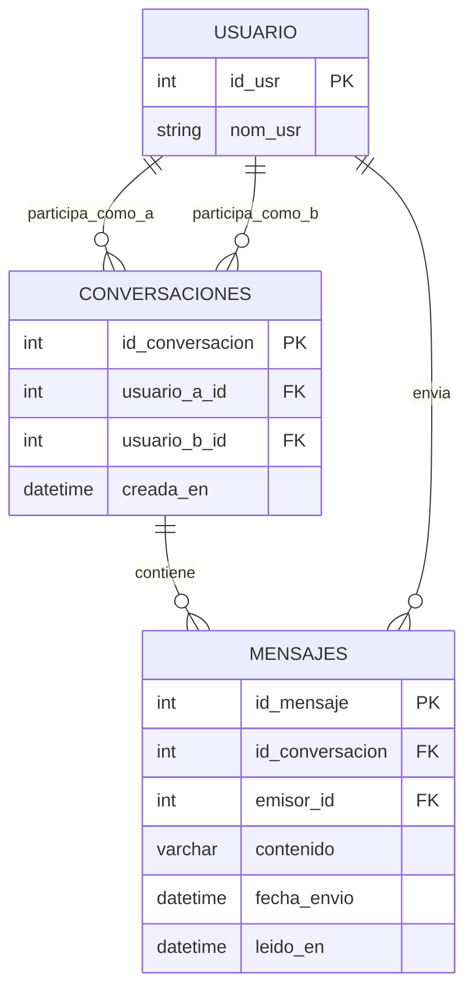

# Diseño de mensajería privada

## Modelo entidad-relación



`usuario_a_id < usuario_b_id` canonicaliza la pareja y una clave única permite un solo hilo por pareja. El `CHECK` también rechaza el auto-chat. Al borrar correctamente cualquiera de los usuarios, la cascada elimina el hilo y sus mensajes.

## Secuencia de abrir, enviar y leer

```mermaid
sequenceDiagram
  actor A as Usuario A
  participant F as Flutter
  participant API as FastAPI
  participant DB as MySQL/MariaDB
  actor B as Usuario B

  A->>F: Selecciona contacto B
  F->>API: POST /mensajes/conversaciones/B (Bearer)
  API->>API: Obtiene A del JWT y ordena IDs
  API->>DB: Busca o crea la pareja única
  DB-->>API: id_conversacion
  API-->>F: 200 existente o 201 nueva
  A->>F: Envía contenido
  F->>API: POST /mensajes/conversaciones/id/mensajes
  API->>API: Valida que A participe
  API->>DB: Inserta emisor A y contenido
  DB-->>API: id_mensaje
  API-->>F: 201 mensaje
  loop Cada 4 segundos mientras B tiene el chat abierto; si está vacío se consulta desde el cursor 0
    F-->>API: GET mensajes?despues_de_id=último_id
    API->>API: Verifica participación de B
    API->>DB: Consulta mensajes nuevos
    DB-->>API: mensajes ascendentes por ID
    API-->>F: Lote incremental
  end
  F->>API: POST /mensajes/conversaciones/id/leidos
  API->>DB: Marca solo mensajes cuyo emisor no es B
```

## Diccionario de datos

| Tabla/campo | Uso |
|---|---|
| `conversaciones.id_conversacion` | Identificador del chat 1:1. |
| `conversaciones.usuario_a_id`, `usuario_b_id` | Participantes; IDs ordenados y pareja única. |
| `conversaciones.creada_en` | Fecha de creación del hilo. |
| `mensajes.id_mensaje` | Orden estable y cursor incremental del mensaje. |
| `mensajes.id_conversacion` | Hilo al que pertenece. |
| `mensajes.emisor_id` | Cuenta que envió; se deriva del JWT en la API. |
| `mensajes.contenido` | Texto hasta 2,000 caracteres. |
| `mensajes.fecha_envio` | Fecha de inserción. |
| `mensajes.leido_en` | Marca interna para contar mensajes recibidos no leídos; no se expone como recibo visible. |

## Seguridad y límites

Las rutas requieren JWT y verifican la pertenencia al hilo. Un tercero, incluso administrador, recibe el mismo 404 que un hilo inexistente. La lista de contactos solo entrega ID y nombre; excluye a la cuenta actual y la búsqueda filtra localmente la lista completa. Los mensajes se guardan en texto plano en la base y no tienen cifrado de extremo a extremo; el despliegue debe usar HTTPS. Esta versión no aplica rate limit, no permite bloquear/reportar y no ofrece editar/borrar mensajes.